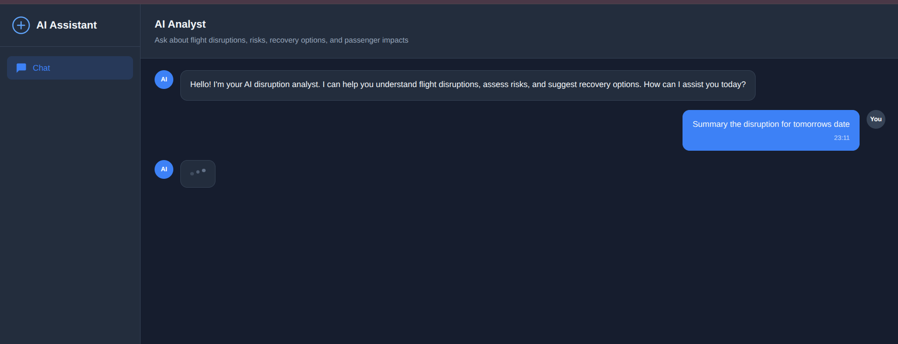

# Disruption Intelligence AI Assistant

An AI-powered disruption analysis assistant that combines Retrieval-Augmented Generation (RAG) with structured CSV data analysis to help operations control centre (OCC) duty managers make real-time decisions during flight disruptions.

The chatbot, **"Maya"**, acts as a senior disruption analyst with 15 years of OCC experience, providing conversational, data-grounded advice on flight delays, cascade risks, passenger impacts, and recovery options.

> **Note**: This project is an extension of an existing airline disruption analysis system. The analysis output is generated by an AI model trained on real airline operational data, providing accurate risk assessments and recovery recommendations based on actual flight patterns, rotation schedules, and passenger connection data.

---

## Architecture

```
┌─────────────────────────────────────────────────────────────────┐
│                        Client (Browser/API)                     │
└──────────────┬──────────────────────────────────┬───────────────┘
               │                                  │
               ▼                                  ▼
   ┌───────────────────────┐         ┌───────────────────────────┐
   │   Chat Endpoints       │         │  Disruption Analysis API   │
   │   POST /api/chat       │         │  GET /api/disruption/*     │
   │   POST /api/chat/stream│         │  POST /api/disruption/...  │
   └───────────┬───────────┘         └──────────────┬────────────┘
               │                                    │
               ▼                                    ▼
   ┌───────────────────────┐         ┌───────────────────────────┐
   │     ChatService        │◄────────│  DisruptionAnalysisService │
   │  (RAG + Gemini LLM)    │         │  (CSV data analysis)       │
   └───────────┬───────────┘         └──────────────┬────────────┘
               │                                    │
               ▼                                    ▼
   ┌───────────────────────┐         ┌───────────────────────────┐
   │   VectorStore (pg)     │         │   CSV Data Files           │
   │  (pgvector + Gemini    │         │  (rotation risk, passenger │
   │   embeddings)          │         │   priority, recovery, etc.)│
   └───────────────────────┘         └───────────────────────────┘
```

## Tech Stack

| Component | Technology |
|---|---|
| Framework | Spring Boot 4.2, Java 17 |
| AI Model | Google Gemini 3.1 Flash Lite (chat) + Gemini Embedding 001 (embeddings) |
| Vector Store | PostgreSQL 17 with pgvector (3072 dimensions) |
| Build Tool | Gradle |
| CSV Processing | OpenCSV 5.9 |
| Containerization | Docker Compose |
| Frontend | Vanilla HTML/CSS/JS (served by Spring Boot) |

---

## UI Interface

The application includes a built-in web UI accessible at **http://localhost:8081** after starting the server.

### Screenshot



### Features

- **Chat Interface**: Conversational AI interface for asking natural language questions about disruptions, with source citations and quick-query hint buttons. The UI features a dark-themed design with real-time connection status indicator and responsive layout for mobile devices.

---

## Prerequisites

- **Java 17** or higher
- **Gradle 8.x** (wrapper included)
- **Docker & Docker Compose** (for PostgreSQL with pgvector)
- **Google API Key** with access to Gemini models

---

## Quick Start

### 1. Start PostgreSQL with pgvector

```bash
docker-compose up postgres
```

This starts a PostgreSQL 17 container with the pgvector extension, creates the `ai_assistant` database, and initializes the `vector_store` table.

### 2. Configure Environment Variables

Create a `.env` file in the project root:

```env
GOOGLE_API_KEY=your-google-api-key-here
DB_USER=ai
DB_PASSWORD=ai
RAG_DATA_DIR=./src/resources/output/
```

### 3. Prepare Data Files

Place your disruption CSV files in `src/main/resources/output`. The application expects the following files:

| File | Description |
|---|---|
| `rotation_risk_scores_21-30Nov.csv` | Flight delay probabilities, cascade risk, and rotation data |
| `passenger_priority_scores.csv` | Passenger priority scores for rebooking decisions |
| `misconnection_risk_scores.csv` | Connecting passenger misconnection probabilities |
| `recovery_recommendations.csv` | Alternative flight recommendations for disrupted flights |

### 4. Run the Application

```bash
./gradlew bootRun
```

The server starts on **http://localhost:8081**. The web UI is available at the same URL.

### 5. Ingest Documents (Optional)

Document ingestion runs automatically on startup. To trigger it manually:

```bash
curl -X POST http://localhost:8081/api/ingest
```

---

## API Endpoints

### Chat

| Method | Endpoint | Description |
|---|---|---|
| `POST` | `/api/chat` | Send a chat message and receive a response (JSON) |
| `POST` | `/api/chat/stream` | Send a chat message and receive a streaming response (SSE) |

**Request body:**
```json
{
  "message": "What are the major disruptions expected today?",
  "conversationId": "optional-uuid-for-multi-turn-chat"
}
```

**Response:**
```json
{
  "response": "The headline today is...",
  "sources": [
    { "name": "rotation_risk_scores_21-30Nov.csv", "snippet": "..." },
    { "name": "DisruptionAnalysisService", "snippet": "Structured analysis..." }
  ]
}
```

### Disruption Analysis

| Method | Endpoint | Description |
|---|---|---|
| `GET` | `/api/disruption/summary` | Overall disruption summary statistics |
| `GET` | `/api/disruption/high-risk?topN=10` | Top flights by delay probability |
| `GET` | `/api/disruption/severe-delay?topN=10` | Flights with highest severe delay probability (>60 min) |
| `GET` | `/api/disruption/cascade-risk?topN=10` | Flights with highest downstream cascade risk |
| `GET` | `/api/disruption/passenger-priority?topN=10` | Flights with highest passenger priority scores |
| `GET` | `/api/disruption/misconnection?threshold=0.5&topN=10` | High misconnection risk connections |
| `GET` | `/api/disruption/recovery?flightNumber=G9406` | Recovery options for a disrupted flight |
| `GET` | `/api/disruption/flights-by-date?date=2026-11-21` | Flights scheduled for a specific date |
| `GET` | `/api/disruption/flights-by-route?dep=SHJ&arr=DEL` | Flights on a specific route |
| `GET` | `/api/disruption/flights-by-registration?reg=A6-ARG` | Flights for a specific aircraft |
| `POST` | `/api/disruption/analyze` | Comprehensive analysis for a natural language query |
| `POST` | `/api/disruption/context` | Get data context for RAG enrichment |
| `POST` | `/api/disruption/reload` | Force reload all cached CSV data |

### Document Management

| Method | Endpoint | Description |
|---|---|---|
| `POST` | `/api/ingest` | Trigger manual document ingestion |
| `DELETE` | `/api/documents` | Clear all documents from the vector store |

---

## Configuration

All configuration is in `src/main/resources/application.yaml`:

| Property | Default | Description |
|---|---|---|
| `spring.ai.google.genai.chat.model` | `gemini-3.1-flash-lite` | Gemini chat model |
| `spring.ai.google.genai.chat.temperature` | `0.5` | Chat temperature (lower = fewer hallucinations) |
| `spring.ai.google.genai.embedding.text.model` | `gemini-embedding-001` | Embedding model |
| `spring.ai.vectorstore.pgvector.dimensions` | `3072` | Embedding vector dimensions |
| `spring.datasource.url` | `jdbc:postgresql://localhost:5432/ai_assistant` | Database connection |
| `rag.data-dir` | `src/main/resources/output` | Directory containing CSV/JSON data files |
| `rag.manifest-path` | `./src/resources/.ingest-manifest.properties` | Ingestion manifest for change detection |
| `rag.top-k` | `5` | Number of RAG documents to retrieve per query |
| `rag.similarity-threshold` | `0.5` | Minimum cosine similarity for RAG retrieval |
| `server.port` | `8081` | HTTP server port |

All properties can be overridden via environment variables (e.g., `RAG_DATA_DIR`, `GOOGLE_API_KEY`).

---

## How It Works

### RAG Pipeline

1. **Ingestion**: On startup, `DocumentIngestionService` scans the data directory for CSV and JSON files. Each file is parsed, summarized (statistics, top-N rows, distributions), chunked, and embedded using Gemini Embedding 001. Chunks are stored in PostgreSQL via pgvector.

2. **Change Detection**: A manifest file tracks file fingerprints (size + last-modified time). Unchanged files are skipped on restart, avoiding unnecessary embedding API calls.

3. **Rate Limiting**: Embedding requests are throttled to 60 requests/minute to stay within Gemini free-tier limits, with automatic retry on 429 (quota exceeded) responses.

### Chat Flow

1. User sends a natural language query.
2. **RAG retrieval**: The query is embedded and used to search the vector store for relevant document chunks (top-K by cosine similarity).
3. **Structured analysis**: `DisruptionAnalysisService` detects the query's intent (risk, cascade, passenger, misconnection, recovery) and extracts the top relevant rows from CSV data.
4. **Prompt assembly**: The system prompt ("Maya" persona), RAG context, and structured analysis context are combined.
5. **LLM generation**: Gemini generates a grounded, conversational response citing source files.
6. **Response**: The answer and source references are returned to the client.

### Conversation Memory

Multi-turn conversations are supported via `MessageWindowChatMemory` (10-message sliding window), keyed by `conversationId`.

---

## Project Structure

```
src/main/java/com/ai/assistant/aiassistant/
├── AiAssistantApplication.java        # Spring Boot entry point
├── config/
│   ├── ChatClientConfig.java          # ChatClient + conversation memory setup
│   └── RAGProperties.java             # RAG configuration properties
├── controller/
│   ├── ChatController.java            # Chat and streaming endpoints
│   ├── DisruptionAnalysisController.java  # Structured disruption query endpoints
│   └── DocumentController.java        # Document ingestion management
├── dto/
│   ├── ChatRequest.java               # Chat request DTO
│   ├── ChatResponse.java              # Chat response with sources
│   └── DisruptionAnalysisResponse.java # Structured analysis response
├── service/
│   ├── ChatService.java               # RAG + LLM chat orchestration
│   ├── DisruptionAnalysisService.java # CSV data analysis and intent detection
│   └── DocumentIngestionService.java  # File ingestion, chunking, embedding
└── util/
    └── CsvUtil.java                   # CSV line parsing utility

src/main/resources/
├── application.yaml                   # Application configuration
├── db/init.sql                        # PostgreSQL schema initialization
├── output/                            # Data files directory (CSV/JSON)
└── static/                            # Web UI files
    ├── index.html                     # Main UI page
    ├── css/style.css                  # UI styles (dark theme)
    └── js/app.js                      # UI logic and API integration
```

---

## Database Schema

The `vector_store` table stores document chunks and their embeddings:

```sql
CREATE TABLE public.vector_store (
    id        uuid DEFAULT uuid_generate_v4() PRIMARY KEY,
    content   text,                          -- chunk text
    metadata  json,                          -- source_file, source_path, file_type, chunk_index
    embedding vector(3072)                   -- Gemini embedding vector
);
```

**Note**: HNSW indexing is not used because pgvector limits HNSW to 2000 dimensions, while Gemini embeddings use 3072 dimensions. Similarity search uses brute-force cosine distance.

---

## Development

### Build

```bash
./gradlew build
```

### Run Tests

```bash
./gradlew test
```

### Run with Docker

```bash
docker-compose up --build
```

### Clear Vector Store

```bash
curl -X DELETE http://localhost:8081/api/documents
```

### Reload CSV Data

```bash
curl -X POST http://localhost:8081/api/disruption/reload
```

---

## Example Queries

```bash
# Chat query
curl -X POST http://localhost:8081/api/chat \
  -H "Content-Type: application/json" \
  -d '{"message": "What are the major disruptions expected today?"}'

# Get high-risk flights
curl http://localhost:8081/api/disruption/high-risk?topN=5

# Get recovery options for a flight
curl "http://localhost:8081/api/disruption/recovery?flightNumber=G9406"

# Analyze a natural language query
curl -X POST http://localhost:8081/api/disruption/analyze \
  -H "Content-Type: application/json" \
  -d '{"query": "Which flights have the highest cascade risk?"}'
```

---

## License

Private project — Disruption Intelligence Operations.
